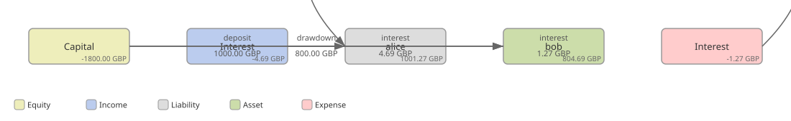
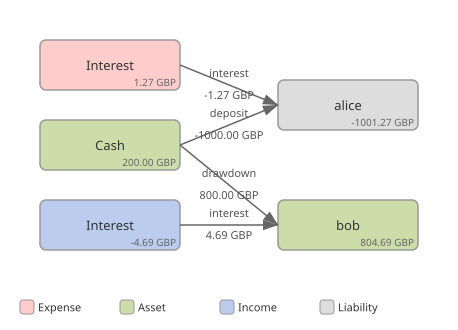
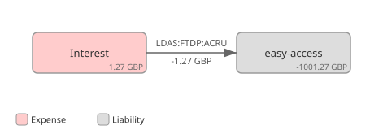

# ADR-0008: The ledger is the bank's view

Status: Accepted
Date: 2026-10-10, accepted 2026-10-11
Stage: ADR-0002 stage 8 (roadmap 1.8), story 1.8.2a, before 1.8.2 completes

## Context

go-luca's balance is money in less money out, and a movement moves an
amount from one account to another. The bank posts a deposit from
`Equity:Capital` to the customer's savings account, so a savings balance
is positive, like a loan's; interest applied to savings posts from
`Expense:Interest` to the account, so the expense runs negative; a loan
drawdown posts from equity too, so equity runs negative.

This is the crux. A worked month as the bank writes it today, drawn by
[pta2svg](https://git.bytestone.uk/hum3/pta2svg) from
[0008-today.goluca](0008-today.goluca): Alice deposits £1,000, Bob draws
an £800 loan, and at the month end 1.5% and 6.9% are applied. Each node
carries the balance it is left with, computed from the movements as
go-luca computes it.

The chart is signed by the direction each event happened to be written
in, not by what the accounts are. Every read, from the book to the
balance sheet to the P&L, carries a sign correction for it.

The product contract (ADR-0006, gobank-products v0.6.0) is written in
the bank's view: a savings balance is a liability and negative, a loan
an asset and positive, and the term, allowance and overdraft rules read
a movement's direction that way. The same month in that view
([0008-decided.goluca](0008-decided.goluca)), with cash where equity was:

Integrating the contract (story 1.8.2) the ISA counted every deposit as
a withdrawal. Two conventions met, and one has to go. For the view
itself, double entry as a directed graph with debit and credit as
nothing more than positive and negative, see *Accounting for
Programmers* ([bytestone.uk/afp](https://www.bytestone.uk/afp/)).

## Decision

All contracts and code are written from the bank's view; presentation
may vary. The ledger, the sub-ledger and the general ledger alike, holds
the bank's view: debit-normal accounts (assets, expenses) carry positive
balances, credit-normal accounts (liabilities, equity, income) negative.
A movement is from the account credited to the account debited. That is
go-luca's semantics read as accounting, and the directed-graph approach
of *Accounting for Programmers*: the account money leaves is credited,
the account it reaches is debited. Engineers read and write in
this view; the customer's view, in which both savings and loans are
positive, is presentation and switchable.

| Account | Normal | Sign in the ledger | Holds |
|---|---|---|---|
| `Asset:Cash` (new) | debit | + | the bank's cash from customer flows: deposits in, drawdowns out |
| `Asset:Loans:<customer>:<product>` | debit | + | what a borrower owes |
| `Asset:BoEReserves`, `Asset:AccruedInterest:BoE` | debit | + | unchanged |
| `Liability:Savings:<customer>:<product>` | credit | − | what the bank owes a saver |
| `Equity:Capital` | credit | − | the bank's capital; no longer the counterparty of customer flows |
| `Income:Interest`, `Income:Interest:BoE` | credit | − | unchanged |
| `Expense:Interest` | debit | + | was negative |

### Posting directions

| Event | Credited (from) | Debited (to) | Effect |
|---|---|---|---|
| Deposit, savings funding | the savings account | `Asset:Cash` | savings more negative, cash up |
| Withdrawal to the outside | `Asset:Cash` | the savings account | |
| Transfer, A pays B | B's savings account | A's savings account | B more negative, A less |
| Loan drawdown | `Asset:Cash` | the loan account | loans up, cash down |
| Loan repayment | the loan account | `Asset:Cash` | |
| Savings interest applied | the savings account | `Expense:Interest` | the contract's posting of a negative amount from the expense to the account, which the runner posts this way about |
| Loan interest applied | `Income:Interest` | the loan account | unchanged |
| BoE reserve interest | `Income:Interest:BoE` | `Asset:AccruedInterest:BoE` | unchanged |
| GL: control movements and the journal | the same directions, with `Asset:Cash` on the GL's chart | |

The ledger wrapper names its parameters for what they are, `credit` and
`debit`, so a reader is not left to infer which is which from a
direction word.

The two diagrams in the context are these directions, today's and the
decided, over one worked month.

### Reads

| Read | Today | Decided |
|---|---|---|
| The book: savings | the sum of savings positions | the negated sum |
| Funds for a transfer | balance ≥ amount | the negated balance ≥ amount |
| Interest expense to date | the negated expense balance | the expense balance |
| A statement's running balance | in less out, positive | in less out, negative for savings; presented per view |
| Cash | savings less lending, computed | the `Asset:Cash` balance, read; the balance sheet balances from the ledger once 1.6a.3 moves it there |
| The history's daily savings and lending | magnitudes | magnitudes, unchanged: a chart series, not a ledger balance |

### Presentation

| Where | View | Default | Settable |
|---|---|---|---|
| The core's API (`core.Account.Balance` and every figure) | the bank's | | no: the API speaks accounting |
| The staff web | bank's or customer's | the bank's: engineers and staff work in the accounting view | per signed-in session, a switch in the layout |
| The customer app | the customer's: savings and loans both positive | | no |
| The customer app's position with the bank | the bank's view negated: what the bank owes the customer net of what the customer owes, signed | | shown as a total |

### The movement beneath the statement line

A statement line is a presentation of one movement from one account's
side. Beneath it the bank shows the movement itself, as the journal
entry it is: the account credited and the account debited, each with
its type and the balance it was left with, the amount, the value time
and the knowledge time, the code and the description, and for a rule
posting the record ADR-0006 keeps beside it (the version, the event, the
parameters read and the position applied). Drawn as the directed graph
of *Accounting for Programmers* (bytestone.uk/afp): two nodes carrying
their balances, one arrow carrying the amount, coloured by account type.
Every statement line on the staff web links to it; the app follows.

The renderer is pta2svg, the same tool that drew this ADR: the movement
is handed over as goluca text, which is the ledger's own export format,
and drawn where it is shown. On the staff web and the customer web that
is a WASM component built from pta2svg, the first rendering a general
client takes on from the BFF; the Flutter app reaches it through a web
view or is left with the data until it has a renderer of its own. The
core gains a query for one movement by its ID, with both legs, and the
BFF serves it as the page, as goluca text and as data.

What pta2svg needs for this, as of v0.1.6, raised as its issues: a
public library package, its parser, layout and renderer being internal
today ([#5](https://git.bytestone.uk/hum3/pta2svg/issues/5)); a WASM
build ([#6](https://git.bytestone.uk/hum3/pta2svg/issues/6)); opening
balances, so that a single movement is drawn with the balances the
accounts are left with rather than the movement's own net
([#4](https://git.bytestone.uk/hum3/pta2svg/issues/4)); names with
spaces, which d2 takes in its stride, for the labels a page shows
([#3](https://git.bytestone.uk/hum3/pta2svg/issues/3)); and two faults:
the goluca parser yields an empty diagram where the pta parser reads the
same text, which is why the files here are rendered with `-format pta`
([#1](https://git.bytestone.uk/hum3/pta2svg/issues/1)), and a hyphen in
an account path (`easy-access`) empties the diagram, so the movement
above spells the product without one
([#2](https://git.bytestone.uk/hum3/pta2svg/issues/2)).

### Running banks

A running bank holds its history in today's signs, and the ledger is
append-only. The demo's data is synthetic, so rather than rewrite its
history the current runs are abandoned: preprod and prod are reset and
start again on this release. The drill for this story is therefore a
fresh deploy, not an upgrade in place, named as the exception to
ADR-0003 that it is: the rollback step does not apply, and the record
says why. A fresh database needs no conversion. A real bank would need
the conversion this ADR does not write; its shape is known (reverse
every movement with a savings account on a side, move funding
counterparties from equity to cash, negate the savings positions and
controls, recompute cash and equity) and it stays unwritten until a bank
with history that matters needs it.

## Choices made, and the alternative to each

| Choice | Alternative | Why this one |
|---|---|---|
| The accounting view in the ledger | positive in the account's own sense | the ledger is the bank's; a liability is a credit; the contract already says so; every sign correction in the reads goes |
| A sign the contract legislates | a sign the rule reads from the runner | two conventions in one system is the problem, not something to abstract over |
| `Asset:Cash` as the counterparty of customer flows | equity, as today | a deposit is not capital; cash is what the balance sheet is missing |
| Presentation converts; the core does not | a view parameter on the core's queries | one API, one truth; a view is a rendering |
| Reset preprod and prod | convert the stored history once | the data is synthetic and the conversion is a history-rewriting migration nobody needs yet; its shape is recorded for the bank that will |

## Consequences

Easier: the contract runs as released; the balance sheet can be read
from the ledger; the GL reconciles signed sums without special cases;
an engineer reading a movement reads a journal entry, and the movement
page draws it as one.

Harder: the first story whose drill is a reset rather than an upgrade in
place; every place that shows a balance decides its view; the demo books
no capital yet, so equity reads zero until it does.

Given up: the simple confusion of positive numbers everywhere. Debt reads
as what it is, and the customer gets the positive view back in the app.
