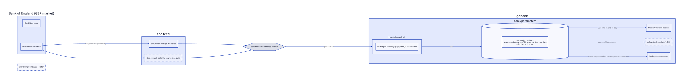

# ADR-0009: Market data and the risk-free rate

Status: Accepted
Date: 2026-10-11
Stage: ADR-0002 stage 8 (roadmap 1.8), story 1.8.4; shapes 1.8.5 and 1.8.6 (now 1.8.7)

## Context

The Bank of England's rate reaches the bank today as a `float64` through
`core.BaseRateSource`: the simulation's `RateSeries`, parsed from a CSV
that `cmd/boefetch` pulls from the Bank's database, answers `BaseRate(day)`;
the bank copies the answer into `boeRate` at each day roll, accrues
reserve interest from it, stores it in `daily_snapshots.boe_rate` as a
double and charts it on the products page. It is the last floating-point
rate in the bank after story 1.8.3, and the only input the bank reads
that no component owns and no record explains.

ADR-0006 planned to make it "a bank-scoped parameter the simulation
writes". Two facts about the rate itself say that is the wrong owner:

- The Bank publishes Bank Rate at 12:00 London on a decision day, and it
  is effective from that moment. The official series since 1694 is on
  the Bank's page, and the same series is served as data (IADB series
  `IUDBEDR`). It is a fact about the pound, not a decision of this bank.
- Every currency has its own: the ECB's deposit facility rate for the
  euro, the Fed's target range for the dollar, each decided and
  published by a different process on a different calendar. A bank that
  holds more than one currency reads more than one.

And one fact about the bank: how it passes a change on, by how much and
after what lag, is the bank's policy, which ADR-0007 puts in the bank's
own module as code that may carry an algorithm. The contract must
therefore not model lag and take as data; it only needs to let a rule
read the market.

## Decision

A currency's official risk-free rate is market data, read by the bank as
a parameter at a scope of its own and written only by its feed.

| Term | Meaning |
|---|---|
| Market | The process that sets a currency's official risk-free rate and publishes it: for GBP the Bank of England, Bank Rate. One per currency. |
| Risk-free rate | The rate the market publishes, in basis points, signed. What a bank's policy derives its own rates from and what the treasury earns on reserves. |
| Source | Where the market publishes: a page for people, a feed for machines, a publication time. GBP: the Bank's Bank Rate page, the IADB series `IUDBEDR`, 12:00 London. Code in `bank/market`, one entry per currency. |
| Decision day | A day the market has said it will publish, from the calendar it issues ahead (the Bank's MPC dates are set a year out). Known in advance; what will be published is not, and often it is no change. |
| Publication | One change: the new rate, effective at the instant published, decided at that instant, by the market. A setting at the `market` scope, owner the currency, key `risk_free_rate_bps`. A decision day that leaves the rate as it was publishes nothing the bank records. |
| Feed | What writes publications into the bank: in the demo the simulation replaying the historical series; in a deployment a poller on the source's feed. Either goes through one core command. |
| Instant | A moment, not a day. A setting is effective from an instant; a rule's parameter for a day is its value at the end of that day. |

### The scope

The contract (gobank-products) gains `ScopeMarket`. A declaration at
that scope names the key only; the owner is the currency of the product
whose rules read it, which the runner knows (`Product.Currency`). The
treasury reads the bank's own currency's rate the same way, through the
parameters component, with no declaration because it is not a rule.

| Scope | Owner | Written by | Read by |
|---|---|---|---|
| market | the currency | the feed, through `core.MarketCommands.Publish` | the treasury; the policy (1.8.6, now 1.8.7); any version that tracks the market directly |
| bank | "bank" | staff; the policy's published values | the policy, versions |
| version | the product's ID | staff; the rules' published values | versions |
| account | the ledger account | the rules at open | versions |

Nothing but the feed writes at the market scope: the staff page does not
offer it, and the policy's spread and lag are bank-scoped parameters of
its own. A market setting is the record of what the market said, and the
bank cannot say otherwise.

### Instants

`parameter_settings.effective_from` is already a timestamp; the day
truncation in `Set` and `Resolve` goes. A rule still asks for a parameter
by day (`Parameter(key, day)`), and the runner resolves it as the value
in effect at the end of that day:

| Setting | Day asked for | Outcome |
|---|---|---|
| effective 12:00 on d | d | the new value: a publication on d counts for the whole of d's accrual, which is the Bank's own convention |
| effective 12:00 on d | d − 1 | the old value |
| effective 00:00 on d (a setting made by day, as the rules' account settings are) | d | the new value, as today |
| effective on d, decided after the moment asked at | any | invisible: a correction is a later decision (ADR-0006) |

The same rule serves the treasury's reserve accrual, so a cut at noon
lowers the whole day's reserve interest. Publication times are stored in
UTC; the source names its local time (12:00 London) and the feed converts.

### Who writes, and when

The core gains `MarketCommands.Publish(ctx, Publication)`, one command
for both feeds. The simulation replays the series: when the bank opens it
publishes everything up to the end of the day in progress, and thereafter
each day's publications at the day roll that closes the day, before the
bank reads the day's rate; until ADR-0010 the clock is the warped wall
clock of stage 4, which flat out never reaches noon, so a publication is
seen on the console the morning after. A publication the bank already has
is not recorded again, so a resumed run, or one upgraded from before the
market was a parameter, replays its whole past once. A deployment's
poller is named here and not built: it reads the feed, compares with the
rate resolved now, and publishes a difference.

A bank with no market setting for its currency on a day cannot start
that day: `StartDay` refuses before the pass and the console names the
silent market. ADR-0006's start-up refusal for a missing bank parameter
stands; a market parameter is refused at the day instead, because the
feed is a core command and so runs after the bank opens.

### Storage

| Table | Owner | Change |
|---|---|---|
| `parameter_settings` | bank/parameters | none: the market scope is a value of `scope`; `effective_from` keeps its full precision |
| `daily_snapshots` | bank/history | `risk_free_bps BIGINT` added; rows from before it are read from `boe_rate` rounded; `boe_rate` is still written as the decimal for the older build of the drill's rollback, and goes a release later |

`bank/market` owns no table (ADR-0001): the sources are code and the
publications are settings. `core.BaseRateSource`, `BaseRateFunc`,
`RatePoint.Rate` and `Position.BoERate` go; `RatePoint.Bps` and
`Position.RiskFreeBps` replace them.

## Choices made, and the alternative to each

| Choice | Alternative | Why this one |
|---|---|---|
| A scope of its own, owner the currency | the bank scope with a prefixed key (`boe.base_rate_bps`), as ADR-0006 had | the market is not the bank: the bank cannot set it, and a second currency is a second owner, not a second key |
| Written only through one core command | the simulation writing settings directly, as it reads `RateSeries` today | the feed and the simulation are the same thing to the bank; stage 9's tests publish a rate the same way |
| Lag and take left out of the contract | `Derivation{Lag, Take}` as data | pass-through is the bank's policy, an algorithm in its own module (ADR-0007); data would be a product designer by another name |
| Effective at an instant; a day's value is its end-of-day value | effective by day, publications dated the day | the Bank publishes at noon and means that day; by-day storage could not say when, and the event clock (ADR-0010) needs the instant |
| Refuse the day, not the open, when the market is silent | refuse the open | the feed is a command on an open bank; refusing the open would need a second path into the settings before the bank exists |
| A rate column in basis points beside the double, both written for a release | convert the column in place | the drill's rollback runs the older build on the same database; it reads `boe_rate` and ignores the new column |

## Consequences

- The treasury is the first reader of a parameter outside the runner:
  `bank/parameters` gains a reader the bank itself uses, and the
  float-free rule (`TestNoFloatMoneyStorage`'s family) covers the whole
  bank.
- The sim's `RateSeries` becomes a replay of publications; its CSV and
  `cmd/boefetch` stay as the series' source, now named by `bank/market`'s
  GBP entry.
- What is upcoming at the market scope is a decision day, never a value:
  the market's calendar says when it will speak, not what it will say,
  and a publication is effective when made. The calendar is data of the
  source, not built here; with the event clock (ADR-0010, story 1.8.5)
  a decision day is an event on the timeline, at which the feed publishes
  a change or nothing, and the products page can name the next one.
  Upcoming values on the products page are staff's settings, from the
  same story.
- A day the market has published no rate for is refused, and the console
  shows the refusal beside the day until a publication lets it start.
- A second currency is a second `Source`, a second owner in the settings
  and, for the treasury, a question this ADR does not answer: which
  currencies' reserves it holds. Out of scope until a product is not GBP.
- ADR-0006's resolution table is amended by this ADR: the bank-scope
  start-up refusal stands; a market-scope miss refuses the day.
