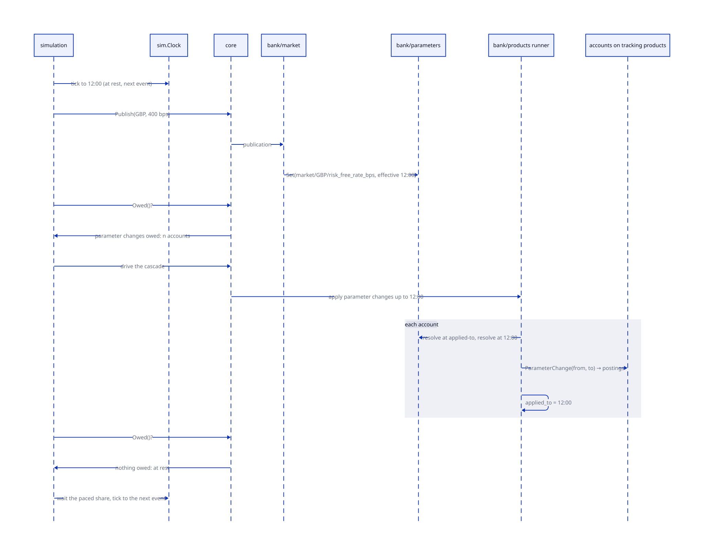

# ADR-0010: The simulation moves by events

Status: Accepted
Date: 2026-10-11
Stage: ADR-0002 stage 8 (roadmap 1.8), story 1.8.5; amends stage 4's clock

## Context

Stage 4 (ADR-0002) gave the simulation a clock the bank reads as it
would the wall: a simulated day is a wall-clock slot, the time of day is
wall time warped into it, and `Step` begins the next day once the bank
reports the current one complete. The payments generator raises payments
during the slot at the wall's pace. It has served: the bank follows the
clock, a cut-short pass resumes, a restart lands on the same day.

ADR-0009 puts an event inside the day. A publication at 12:00 changes a
market parameter; the bank's policy (1.8.6, now 1.8.7) derives new bank rates from
it; product rates derive from those; and every account holding such a
product is owed a `ParameterChange` event (ADR-0006), whose rule may post.
All of that is caused by one instant and must be done before anything
that depends on it: the day's close, a payment whose pre-posting rule
reads the rate, a staff member reading the products page. A slot clock
cannot say when that is. Time flows whether the bank has finished or not,
a payment raised at wall pace interleaves with the cascade, and a short
slot can close the day on a cascade still running, since the day waits
only for the pass. The same is true of a payment: its pre-posting rule,
posting and post-posting rule are one cause with one set of effects.

What the simulation needs is to know when the system is at rest, and
only then to move the clock to the next thing that happens.

## Decision

The simulation is discrete-event. The clock stands at an event's instant
while the bank processes the event and everything it causes; when the
bank reports itself at rest, the clock moves to the next event.

| Term | Meaning |
|---|---|
| Event | Something the bank is told has happened at an instant: the start of a day, a market publication, a payment, a setting becoming effective, a manual command. |
| Timeline | The future events the simulation knows of, in instant order: the next start of day, the series' next publication, the generator's next payment, the settings whose effective instant is ahead. Rebuilt from stored facts at a restart. |
| Cascade | Everything the bank does because of one event, under its own locks and transactions, until nothing is left owed. |
| At rest | The bank has nothing owed: the day's pass complete, no account unprojected, no parameter change unfired, no payment in flight. Reported by the core as counts, so the console can show what is still owed. |
| Tick | The clock's move from the current event's instant to the next event's. Allowed only at rest. |
| Pace | The wall time spent per simulated day, the day-length knob. Spread between events in proportion to the simulated gap between them; flat out spends none. |

### The clock

`sim.Clock` becomes stepped. `Now()` is the current event's instant until
the tick; it does not flow with the wall. The bank's `core.Clock` reading
is unchanged: it reads a time. `Run` records the instant instead of the
day and the slot start, so a restart resumes at the event in progress and
the bank, reading the same instant, finishes the same cascade.

| Clock is at | Bank reports | Clock does |
|---|---|---|
| an event's instant | owed work (counts > 0) | stands; the simulation drives the bank until the counts are zero (`StartDay` for the pass, the runner for parameter changes, the payments path for payments) |
| an event's instant | at rest, a next event on the timeline | waits the paced share of the wall, then ticks to the next instant and raises the event |
| an event's instant | at rest, no next event before the next day | ticks to the next start of day |
| behind the bank's day (a stale record) | — | jumps to the bank's day, as today |

### Parameter change as a cascade

ADR-0006 names the parameters component as what fires `ParameterChange`
"when a setting the version reads becomes effective". The firing is a
function of stored facts so it survives a restart: `bank/products` keeps,
per account, the instant up to which its parameters have been applied.
When the clock is at an instant, the runner resolves each account's
declared parameters at the applied-to instant and at now; a difference
fires the rule with from and to, the postings are recorded as any rule
posting is, and the applied-to instant advances to now. An account whose
resolution is unchanged advances silently. A derived parameter changes
when its source does, so a market publication reaches an account through
the policy and the product's derivation with no list of dependants kept
anywhere.

| Table | Owner | Rows |
|---|---|---|
| `product_account_parameters` | bank/products | one per account: `account_id`, `applied_to` (an instant) |

### Payments and settings as events

The payments generator stops raising at wall pace. It schedules each
payment at a simulated instant from its seed, and the simulation raises
it when the clock reaches it; the payment's pre-posting rule, posting and
post-posting rule run and the bank is at rest again before the next
event. A payment a staff member sends from the console is an event at the
current instant, run at once.

A setting staff make effective at a future instant (a product rate from
the products page, story 1.8.5) is on the timeline from the moment it is
decided: the parameters component answers the next effective instant
after now, and the simulation reads it when it rebuilds the timeline.
Nothing is scheduled: when the clock reaches the instant, the applied-to
comparison above finds the change.

### At rest

`core.StaffQueries` gains `Owed(ctx) (Owed, error)`: the pass in progress
or not, accounts unprojected for the day, accounts whose applied-to
instant is behind the clock, payments accepted and not posted. At rest is
every count zero. The console shows the counts; the drill reads them to
know a deploy has settled; stage 9's tests advance to an event and assert
them.

## Choices made, and the alternative to each

| Choice | Alternative | Why this one |
|---|---|---|
| A stepped clock that stands at an event | the warped wall clock with the day held open until at rest | the cascade would still interleave with payments raised at wall pace; standing still is what makes "everything caused by this instant" a stored fact |
| At rest as counts the core reports | a flag the simulation keeps | the bank knows what it owes and the simulation does not; counts also tell the console what is late |
| An applied-to instant per account | a journal of settings fired per account | the comparison is a function of stored facts and of the resolution rule, so a derived change needs no dependency list; a journal must know what depends on what |
| The generator schedules payments on the timeline | payments at wall pace, paused during a cascade | a pause is a second clock; one timeline keeps one order of events, reproducible from the seed |
| Future settings found by comparison, not scheduled | a scheduler table of pending changes | the setting is already the record; a scheduler is a copy that can disagree |
| The pace spread between events | the pace as a per-day slot | a slot is a day of wall time whatever happens in it; spreading keeps the knob's meaning (wall time per simulated day) while letting an empty afternoon pass quickly |

## Consequences

- ADR-0002 stage 4's clock is amended: still the bank's `core.Clock`,
  still recorded with the run, no longer flowing. A deployment on the
  wall clock is unchanged: the wall is a clock that is always at rest
  between events, and its feed and payments arrive when they arrive.
- The `Run` record changes shape (an instant for a day and a slot
  start): a migration in the simulation component, and the drill's
  rollback reads the older shape, so both are kept for one release.
- `ParameterChange` leaves roadmap 1.8.8 (now 1.8.9) and is built here, because
  without it there is no cascade to wait for.
- The payments generator's throughput becomes a property of the
  timeline (payments per simulated day) rather than of the wall, which
  the throughput readings on the console must be re-stated in.
- The at-rest counts are the first thing the drill can wait on that is
  not a page: gobank-deploy may use them to know a restart has settled
  (`/about.json`, `sim.owed.at_rest`).

## As built (story 1.8.5)

- The cascade is part of `StartDay`: the bank follows its clock in one
  command, the days first and then the parameter changes owed by the
  instant, so the simulation drives the bank with one call until `Owed`
  is zero. `Owed` lives in `core.BookQueries`.
- A payment is completed when accepted: the posting is the settlement,
  stamped by the clock. The asynchronous Pending → Processing →
  Completed walk of the earlier demo is gone, since a payment "settling"
  at a later event's instant would be a stamp with no cause; a payment a
  previous process left in flight is settled when the bank reopens.
- The market's calendar is code in `bank/market` (`Source.Calendar`,
  the MPC's announcement dates from 2020), read through
  `core.MarketQueries`; the series' publications are events of their
  own, so a change the calendar does not know is still raised at its
  instant.
- Which accounts are owed is a query over stored facts: a setting at a
  scope the account's rules read, effective after the account's
  applied-to instant and by the clock's, through the parameters
  component's `contract_parameter_settings` view (ADR-0001). An account
  from before the record is adopted silently at the first cascade.
- The changes for an account are found before any rule fires, so what a
  rule writes in answer (an account setting) is not a change of its own.
- The feed catches up only to the clock's instant when the bank opens:
  the opening day's rate arrives with the noon publication, an event.
- A staff setting's instant is UTC and not before the clock; empty means
  the bank's day, in force at once. The set is a core command,
  `SetParameter`, refusing a derived or undeclared key, a value not of
  the parameter's kind, or an instant in the past.
