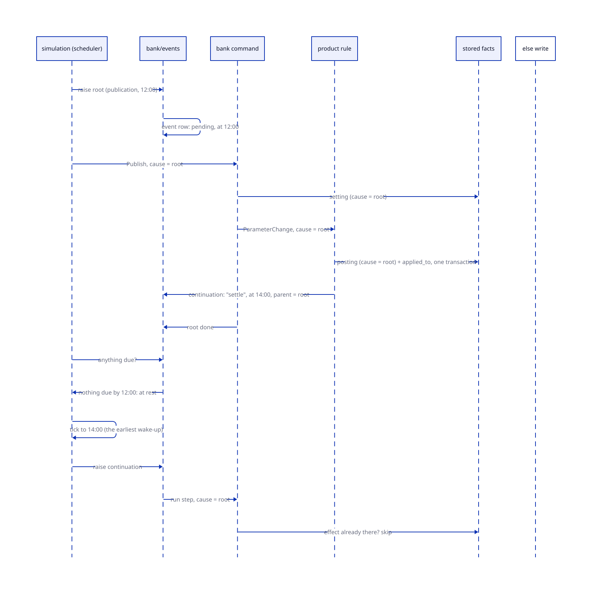

# ADR-0011: Events and their cascades are recorded

Status: Proposed
Date: 2026-10-11
Stage: ADR-0002 stage 8 (roadmap 1.8), a story before 1.8.6; the first form of the roadmap's workflow engine

## Context

ADR-0010 made the simulation discrete-event: the clock stands at an
event's instant while the bank processes it and everything it causes,
and moves on only when the bank is at rest. It answers "is the bank at
rest" by counting stored facts: accounts without a position for the
day, accounts whose applied-to instant is behind the clock, payments
not completed. It answers nothing about cause. A posting made because
the Bank of England published at noon is recorded with its event kind
and the parameters read, not with the publication; nothing says which
root a piece of work belongs to, or whether a given root's cascade has
finished.

Four roots exist today (the start of a day, a publication, a payment, a
staff setting) and each cascades: a payment through pre-posting,
posting, post-posting and the GL control; a publication through the
parameter changes it fires. Story 1.8.6 adds a longer chain, the market
rate reaching the bank's policy, the policy the product rates, the rates
every account. The roadmap's workflow engine (KYC onboarding, lending
proposals, dormancy, promotion) is the same shape again: a root event, a
tree of effects, some of them timers and human steps that park the
cascade and wake it later. What is wanted is one record of that shape,
written cooperatively by the code that runs it.

The model is a scheduler over parked processes. A cascade is a
goroutine; a sleep is a park with a wake-up instant; the clock advances
only when every process is parked, and advances to the earliest
wake-up. The one place the analogy breaks is a restart: a goroutine does
not survive one, so a parked cascade must be data.

## Decision

Every unit of work the bank does runs because of one event, names it on
what it writes, and the event's record says whether the cascade it
roots is finished. On a restart the root is raised again, not its
effects: every effect is idempotent and proven by a fact, so a replay
skips what was done and does what was not.

| Term | Meaning |
|---|---|
| Event | Something that happened at an instant and is on record as such: a publication, a payment, a start of day, a staff decision, a continuation firing. Roots and continuations only; effects are not events. |
| Cause | The event a unit of work runs because of. Every command and every rule firing has exactly one: the command is the root and writes it; a continuation inherits its root's. |
| Effect | What the work wrote: a posting, a setting, a position, a further event. Carries its cause. |
| Fact | The row that proves an effect happened: the position, the posting record keyed by cause, account and step, the setting, the payment. Written in the same transaction as the effect, before the effect. |
| Continuation | An effect that is an event at a later instant, with the root as its parent: a rule's sleep, a maturity, a notice period ending, a human step awaited. |
| Cascade | A root, its effects, its continuations and theirs, until none is pending. |
| At rest | No event is due at or before the clock's instant and unfinished. A continuation ahead of the clock is on the timeline, not owed. |

### The record

| Table | Owner | Rows |
|---|---|---|
| `events` | bank/events | one per root or continuation: `id`, `kind`, `at` (the instant), `parent_id` (null for a root), `root_id`, `status` (pending, done, waiting on whom), `raised_by`, `done_at` (wall, operational) |

The command is the root. `StartDay` writes the day's event, `Publish`
the publication's, `Transfer` the payment's, `SetParameter` the
decision's, each in its own transaction, and passes the id down to the
runner; `core.Commands` is unchanged and the simulation and the staff
web call them as they do today.

Postings (`product_postings`), settings (`parameter_settings`) and
payments gain a `cause_id`; postings gain a `step` too, with a unique
key on `(cause_id, account_id, step)`. Positions gain nothing: a
position's cause is the start of its day, and the pass over 100,000
accounts must not write 100,000 effect rows. The rule is that an effect
is recorded as a row of its own only when nothing else records it; the
cascade's completion is always the status on its root.

### Accruals

The start of day is one root. Each account's day rule is an effect whose
fact is its position row, which the resume already reads ("accounts
without a position for the day"); no event is written per account. The
application at a cycle end is the one per-account effect with a record
of its own: a posting under the day's cause, step `apply`, so a replay
finds it by the key whatever the position's arithmetic says.

### Replay, not resume

A restart finds every event that is pending and due, and raises each
again at its recorded instant, under the same cause. The code that runs
the cascade looks for each effect's fact before writing it: a position
for the day, a posting with this cause and step, a setting with this
effective instant and decision. Found, it is skipped; missing, it is
written, with its fact, in one transaction. The root is marked done in
the transaction that writes its last effect, so a crash between leaves
it pending and the next process replays it.

This is the discipline ADR-0010 already asks for, made a rule: no effect
without a fact that proves it happened, and no fact outside the effect's
transaction. Three things make it structural rather than a property each
rule has to get right:

- Each account's work in the pass runs in a transaction of its own, as
  the parameter cascade does: the movement, the posting record and the
  rewritten position commit together or not at all. Today they are
  separate statements, and a crash between the movement and the
  position would apply a cycle's interest twice on replay.
- A rule's posting names its step (the contract's `Posting` gains one;
  a rule that posts twice under one cause names two steps), and the
  runner inserts the posting record, keyed by cause, account and step,
  before the movement, inside the transaction. A replay that reaches a
  step already done hits the key and skips; the database enforces it.
- A kill-and-replay test: a cascade run with a hook that fails the
  transaction after each effect in turn, the root replayed, and the
  facts asserted identical to an uninterrupted run. One table-driven
  test, the proof for every rule.

### Continuations

A rule that needs the bank to do something later returns an intent: a
continuation at an instant, with a step name and the data the step
needs. The runner writes it as an event with the current cause as its
parent, and the simulation's timeline reads it with the other upcoming
events. When the clock reaches it, the runner raises it: the step runs
under the root's cause, and may continue again. A deployment on the
wall clock raises continuations as their instants pass.

A human step is a continuation with no instant and a status of waiting:
it is raised when the person acts, through a command that names it.
This is the roadmap's workflow engine: an instance is a root event, its
steps are continuations, and its definition is the code that answers
each step.

### Sim time stands inside a cascade

Simulated time never reads the wall. A cascade is instantaneous in sim
time whatever it costs the machine, so a run is reproducible from its
seed and its roots. If the bank's model wants a cascade to take bank
time (the pass completes at 06:00, a payment settles two hours after
acceptance), that is a duration in the rules, written as a
continuation, and it says what the bank does rather than what the
machine did. The capacity question (could this machine run the pass
overnight) is a wall measurement reported beside the simulation, as
account-days per 12h is today, never a clock setting.

### At rest and the timeline

`core.Owed` is read from the record: the roots and continuations due by
the clock's instant and not done, with the pass's unprojected count
beside them, since the pass's facts are the positions and it keeps its
own resume. The simulation's timeline reads the next continuation from
the same table it reads upcoming settings from today, and raises roots
by writing them there first. The console shows cascades in progress by
root, and a posting's page names its cause.

## Choices made, and the alternative to each

| Choice | Alternative | Why this one |
|---|---|---|
| Replay the root on restart | resume from recorded effects | effects are already proven by facts, so a replay finds them; the table stays roots and continuations, and the discipline is one rule rather than a journal to keep consistent |
| The command writes the root | a cause parameter on every command | the simulation and the web already say what they do by which command they call; a parameter would change every signature to carry what the bank can write itself |
| Idempotency by a unique key on (cause, account, step) | idempotency by the rules' arithmetic alone | the arithmetic holds only when the facts it reads are consistent, which separate statements do not guarantee; a key makes a double effect impossible, not merely unlikely |
| Roots and continuations as rows, effects as a cause column | a row per effect | the pass would write a row per account per day for nothing the position does not already say; provenance needs the cause, not the row |
| A continuation is data on the timeline | a parked goroutine | a goroutine does not survive a restart; written down, a park resumes at its instant under its root |
| Sim time stands inside a cascade | a cascade spends sim time in proportion to wall time | results would depend on the machine; a bank-time duration is a modelling decision, stated as a continuation |
| A bank component, `bank/events` | a library | one user; a second one earns the extraction (ADR-0007's rule) |
| The pass keeps its own resume | the pass as a cascade of per-account effects | its facts are the positions; the start of day is a root whose completion is "no account unprojected", which the record already reports |

## Consequences

- `core.Commands` is unchanged: each command writes its root and the
  bank carries the cause down. The BFF's and the staff web's `By` names
  who acted; the event names what.
- `Owed` changes from a sum of component counts to a read of one table
  plus the pass's count. ADR-0010's stored-facts comparison for
  parameter changes stays as the way to find which accounts a setting
  reaches; the firing records its cause.
- The first slice, a story before 1.8.6 so the policy cascade is built
  on it: the events table with roots only; `cause_id` on postings,
  settings and payments, `step` on postings with the unique key; each
  account's pass work in a transaction; `Owed` from the record; the
  console's cascades by root; the kill-and-replay test. No
  continuations, no human steps, no signature changes. Continuations
  come with the first rule that needs one (a term's maturity, 1.8.8);
  human steps with the first workflow (KYC onboarding).
- gobank-products changes once: `Posting.Step`. The v1 rules name their
  one posting `apply`.
- The roadmap's open question, whether the start-of-day pass becomes a
  workflow instance, is answered: it is a root with the positions as its
  facts, not an instance with a row per step.
- The drill waits on `at_rest` as before; a cascade pending across a
  restart is replayed by the new build, which the drill should see.
- Idempotency is structural from the first slice, not added later: the
  key refuses a double effect, the transaction refuses a half one, and
  the replay test is the proof. The cost is a step name on every
  posting a rule makes, and a transaction per account in the pass,
  which the parameter cascade already pays.
